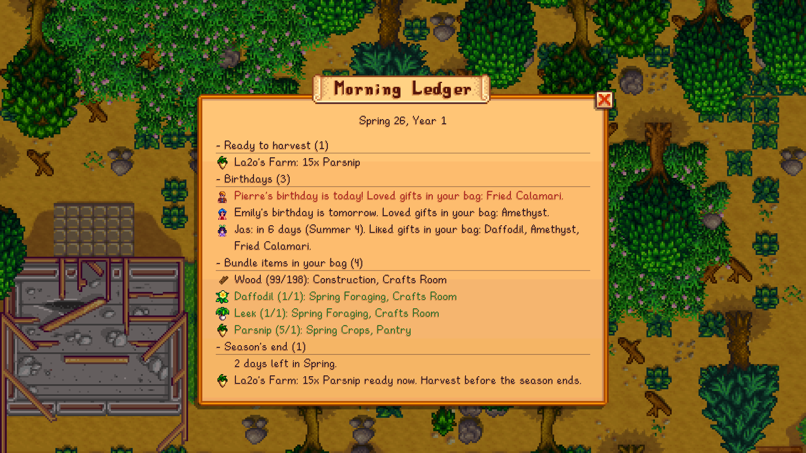
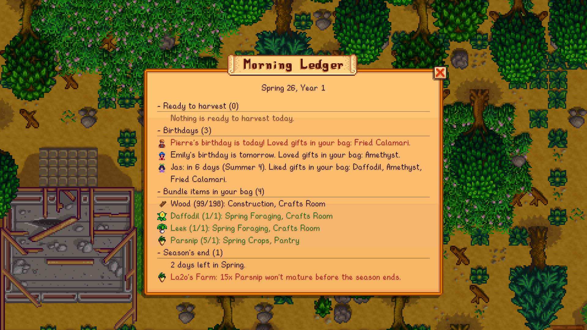

# Morning Ledger

A daily planner for Stardew Valley. Every morning it opens one panel with everything worth knowing today, so you don't need a separate mod for each piece.

## How it's different

Popular mods like Lookup Anything, Data Layers, and UI Info Suite 2 show details about whatever you point at, overlay the map you're standing on, or put icons on the HUD. Each covers one piece, and you have to go looking. Morning Ledger takes a different approach:

- **One place, once a day.** One panel when you wake up, then it gets out of your way. Nothing stays on screen.
- **The whole world, not the current screen.** It checks every farm building, the greenhouse, and the island at once, so you don't have to walk around or hover over each crop.
- **Connects the pieces.** It cross-checks your inventory against birthdays and bundles: "Emily's birthday is tomorrow, and you're carrying an Amethyst" or "this Leek finishes Spring Foraging."
- **Looks ahead.** It warns you before the season change wipes out crops that can't mature in time, a problem most info mods don't flag.
- **Works alongside the others.** It doesn't patch the game or change any vanilla UI, so you can keep your favorite lookup and overlay mods.

## What it shows

| Section | What's in it |
| --- | --- |
| **Ready to harvest** | Fully grown crops, garden pots, and fruit trees with fruit, grouped by location. Machines with finished output can be included too (off by default). |
| **Birthdays** | Villagers with birthdays in the next 7 days. Today's birthdays are highlighted until you've given a gift, and it lists loved or liked gifts you're carrying for each person. |
| **Bundle items in your bag** | Anything in your inventory that an unfinished Community Center bundle still needs, with how many you have against how many it needs. Hidden until you can read the bundles, and on the Joja route or once the Community Center is restored. |
| **Season's end** | Outdoor crops that won't survive into next season. Crops that can't mature before day 28 are always shown in red. In the last week, every crop still in the ground is listed, so you know what to harvest. |

## Controls

- The ledger opens on its own when you wake up. You can turn this off.
- **L** opens or closes it at any time.
- Click a section header to collapse it.
- Scroll with the mouse wheel, the arrow keys or W/S, or the D-pad.
- **Esc** or the close button shuts it.

## Install

1. Install [SMAPI](https://smapi.io) 4.0 or newer.
2. Download the latest version from [Nexus Mods](https://www.nexusmods.com/stardewvalley/mods/54688) or [GitHub Releases](https://github.com/La2o/StardewValley-MorningLedger/releases).
3. Unzip it into `Stardew Valley/Mods`.
4. Launch the game through SMAPI.

Requires Stardew Valley 1.6 or newer. Tested on 1.6.15 with SMAPI 4.5.2.

## Config

The mod creates `config.json` in its folder the first time it runs. You can also change these settings in game with [Generic Mod Config Menu](https://www.nexusmods.com/stardewvalley/mods/5098).

| Setting | Default | What it does |
| --- | --- | --- |
| `ToggleKey` | `L` | Opens or closes the ledger. Accepts any SMAPI keybind, like `LeftShift + L`. |
| `AutoOpen` | `true` | Opens the ledger when you wake up. |
| `SkipIfEmpty` | `true` | Skips the automatic open on days with nothing to show. |
| `BirthdayLookaheadDays` | `7` | How many days ahead to list birthdays. |
| `SeasonEndWarningDays` | `7` | How many days before season's end to start listing every crop that won't survive. |
| `IncludeMachines` | `false` | Also counts kegs, jars, and other machines with finished output. |
| `ShowHarvest`, `ShowBirthdays`, `ShowBundles`, `ShowSeasonEnd` | `true` | Turns each section on or off. |

## Console command

Type `ledger` in the SMAPI console to print today's ledger. This helps when reporting a bug.

## Compatibility

- Built for single player, multiplayer, and split-screen, with a separate ledger for each player. Co-op hasn't been tested much yet, so please report any problems.
- Farmhands in multiplayer only see locations the game has synced to them.
- Bundles and crops are read from the game's own data, so remixed bundles and modded crops should work.
- The days-until-ready numbers assume crops are watered.

## Building from source

1. Install the [.NET SDK](https://dotnet.microsoft.com/download) (version 6 or newer) and SMAPI.
2. Run `dotnet build MorningLedger`. The build finds the game automatically in standard Steam and GOG folders. Otherwise, set `GamePath` in `%USERPROFILE%\stardewvalley.targets`.
3. Debug builds deploy straight to `Mods/MorningLedger`. Run `dotnet build MorningLedger -c Release` to create the release zip in `MorningLedger/bin/Release`.

Debug builds also include two test helpers, which are left out of release builds:

- **F10** saves a native-resolution screenshot, including the UI, to `Mods/MorningLedger/screenshots`.
- **F9** runs the setup commands listed in `Mods/MorningLedger/test-commands.txt`. The available commands are `day N`, `mail ID`, `item ID [count]`, `grow`, `warp LOCATION X Y`, and `ledger`.

## License

[MIT](LICENSE)
